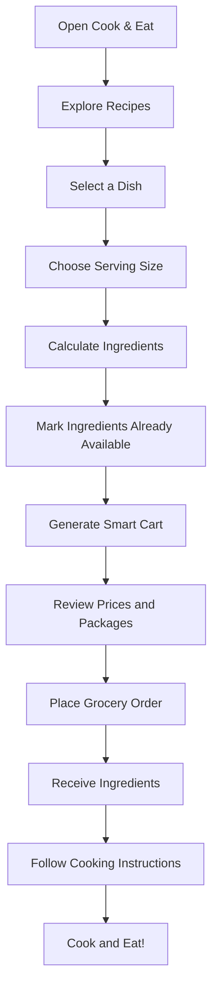
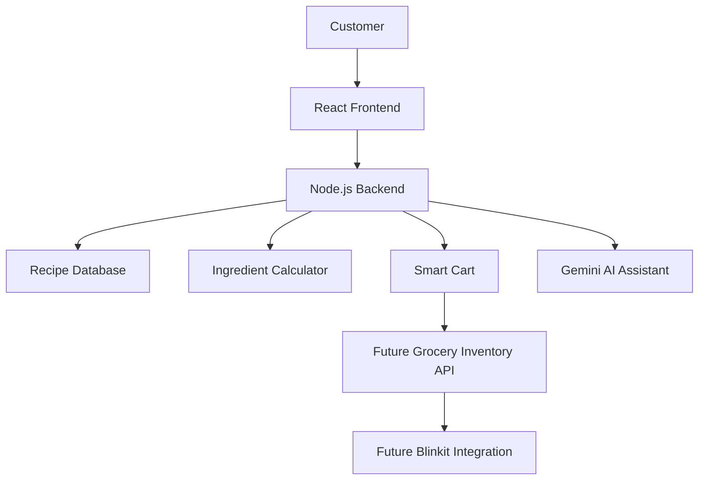

# 🍳 Cook & Eat
### From Craving to Cooking.

> **A recipe-based grocery shopping experience that helps people discover dishes, calculate exact ingredient quantities, order only what they need, and cook with confidence.**

---

## 💡 About the Project

**Cook & Eat** is a proposed quick-commerce feature concept designed around a simple idea:

People often want to cook something delicious but don't know which ingredients are required, how much of each ingredient they need, or where to start.

Cook & Eat aims to solve this problem by allowing customers to select a dish and automatically generate a shopping cart containing all the ingredients required to prepare it.

Customers can exclude ingredients they already have at home, choose their serving size, and receive beginner-friendly cooking instructions.

The long-term vision is to propose Cook & Eat as an innovative feature for **Blinkit**.

**Our vision: Make cooking as convenient as ordering food.**

## 🎯 Problem Statement

Many people love the idea of cooking at home but face several difficulties:

- They don't know all the ingredients required for a particular dish.
- They struggle to calculate the correct ingredient quantities.
- They sometimes purchase ingredients they already have.
- Grocery shopping for a single recipe can be time-consuming.
- Beginners may not know how to prepare a dish step by step.
- Buying ingredients separately creates unnecessary friction.

Traditional grocery shopping starts with selecting products.

**Cook & Eat starts with selecting what you want to cook.**

## 🚀 Our Proposed Solution

Cook & Eat introduces a recipe-first shopping experience.

Instead of searching for individual groceries, customers can:

1. Select the dish they want to prepare.
2. Choose the number of people they are cooking for.
3. View automatically calculated ingredient quantities.
4. Mark ingredients they already have at home.
5. Automatically generate a cart containing only missing ingredients.
6. Order the required groceries.
7. Follow step-by-step cooking instructions.

The concept aims to combine grocery shopping, recipe discovery and cooking guidance into one experience.

## ✨ Core Features

### 1. 🍲 Recipe Discovery
- Browse dishes across different cuisines.
- Search for specific recipes.
- Explore Indian, South Indian, North Indian, Chinese and Italian dishes.
- View preparation time, difficulty and estimated cost.
- Discover dishes based on available ingredients or budget.

### 2. 📏 Smart Ingredient Calculator
- Select serving sizes from 1 to 5 or more people.
- Automatically calculate ingredient quantities.
- Display exact ingredient requirements.
- Adjust quantities dynamically when serving sizes change.

### 3. 🏠 Already Have It?
One of the most important features.

Customers can mark ingredients they already own.

The system automatically excludes those ingredients from the shopping cart.

**Example:**

If a recipe requires:
- 200 g Paneer
- 3 Tomatoes
- 1 Onion
- 30 g Butter
- 50 ml Cream

And the customer already has tomatoes and onions, only the remaining ingredients will be added to the cart.

### 4. 🛒 Smart Shopping Cart
- Automatically generate a cart from missing ingredients.
- Display available package sizes.
- Show estimated prices.
- Allow customers to modify quantities.
- Remove unnecessary items.
- Calculate the total estimated shopping cost.
- Suggest suitable ingredient alternatives when necessary.

The system should distinguish between the exact recipe quantity and the actual grocery package available for purchase.

### 5. 👨‍🍳 Beginner-Friendly Cooking Mode
- Step-by-step cooking instructions.
- Ingredient quantities for each step.
- Estimated preparation and cooking time.
- Beginner-friendly explanations.
- Cooking tips and ingredient substitution suggestions.

### 6. 🤖 AI Cooking Assistant (Future Enhancement)
- Recommend dishes based on preferences.
- Suggest recipes based on available ingredients.
- Answer cooking-related questions.
- Recommend ingredient substitutions.
- Provide personalized cooking suggestions.

## 🔄 How It Works

## 📱 Example User Journey

**Scenario: A customer wants to prepare Paneer Butter Masala for two people.**

| Ingredient | Required Quantity |
|---|---:|
| Paneer | 200 g |
| Tomatoes | 3 |
| Onion | 1 |
| Butter | 30 g |
| Fresh Cream | 50 ml |
| Spices | As required |

The customer already has tomatoes and onions.

Cook & Eat automatically removes those items from the shopping cart.

The customer orders the remaining ingredients and follows the cooking instructions provided by the application.

## ⚡ Proposed Blinkit Integration

The long-term vision is to integrate Cook & Eat into Blinkit's existing quick-commerce ecosystem.

**Proposed customer experience:**

1. Open Blinkit.
2. Select the Cook & Eat feature.
3. Choose a recipe.
4. Calculate ingredients and serving quantities.
5. Exclude ingredients already available at home.
6. Generate a grocery cart.
7. Match ingredients with available dark-store inventory.
8. Place an order.
9. Receive the ingredients and start cooking.

### 10-Minute Delivery Vision

A key part of the original idea is to make cooking ingredients available through Blinkit's quick-delivery model, targeting delivery within 10 minutes wherever operationally feasible.

Actual delivery times would depend on:
- Dark-store inventory.
- Distance from the customer.
- Ingredient availability.
- Order preparation time.
- Delivery partner availability.

The 10-minute target is a proposed experience, not a guaranteed delivery commitment.

## 🏗️ Proposed Technical Architecture

The initial prototype will be developed using Google AI Studio.

| Layer | Proposed Technology | Purpose |
|---|---|---|
| Frontend | React.js | User interface |
| Styling | Tailwind CSS | Responsive design |
| Backend | Node.js + Express.js | Application logic |
| Database | MySQL | Recipes and ingredient data |
| AI Integration | Gemini API | Cooking assistance |
| Prototype Development | Google AI Studio | Initial application generation |
| Version Control | Git + GitHub | Source code management |

### Architecture Overview

*This is a proposed architecture. The initial prototype will use sample data and will not connect to Blinkit's internal systems.*

## 🛠️ Development Roadmap

### Phase 1 — MVP Development

- [ ] Create responsive application interface.
- [ ] Build recipe discovery page.
- [ ] Add initial recipe database.
- [ ] Implement serving-size selection.
- [ ] Implement ingredient quantity calculations.
- [ ] Add Already Have It functionality.
- [ ] Generate automatic shopping carts.
- [ ] Display estimated prices.
- [ ] Implement cooking instructions.
- [ ] Test all major interactions.

### Phase 2 — Smart Features

- [ ] Integrate Gemini AI.
- [ ] Add AI-powered recipe recommendations.
- [ ] Add ingredient substitutions.
- [ ] Add budget-based recipe discovery.
- [ ] Add personalized recommendations.
- [ ] Add nutritional information.
- [ ] Improve recipe accuracy and validation.

### Phase 3 — Product Validation

- [ ] Conduct user interviews.
- [ ] Test with students, working professionals and home cooks.
- [ ] Collect feedback.
- [ ] Measure recipe-to-cart conversion.
- [ ] Evaluate customer satisfaction.
- [ ] Improve the user experience.

### Phase 4 — Blinkit Product Proposal

- [ ] Prepare a professional product requirements document.
- [ ] Prepare a product demonstration.
- [ ] Develop a business proposal.
- [ ] Prepare a presentation for relevant Blinkit product or business development contacts.
- [ ] Explore appropriate partnership or product-feedback opportunities.

## 💼 Business Potential

Cook & Eat could create additional value for a quick-commerce platform.

Potential benefits include:

- Increasing grocery basket value through recipe-based shopping.
- Encouraging customers to explore more grocery categories.
- Improving grocery shopping convenience.
- Creating opportunities for food-brand partnerships.
- Encouraging repeat purchases through personalized recipes.
- Making home cooking more accessible to beginners.

## ⚠️ Challenges & Considerations

| Challenge | Proposed Approach |
|---|---|
| Ingredients unavailable | Suggest verified alternatives |
| Different package sizes | Show available package options |
| Incorrect quantities | Use verified structured recipes |
| Food wastage | Allow exact serving-size adjustments |
| Perishable ingredients | Prioritize fresh inventory |
| Delivery constraints | Display realistic delivery estimates |
| Customer trust | Never force already-owned ingredients into the cart |

## 📊 Success Metrics

The product's success can be evaluated through:

- Recipe selection rate.
- Recipe-to-cart conversion rate.
- Average shopping cart value.
- Percentage of ingredients excluded as already available.
- Order completion rate.
- Customer satisfaction.
- Repeat usage.
- Ingredient substitution acceptance rate.

## 🎨 Design Direction

The proposed visual identity:

- Primary colors: Yellow, Black and White.
- Clean and modern interface.
- Mobile-first experience.
- Attractive food photography.
- Simple recipe cards.
- Easy-to-use ingredient checklists.
- Clear shopping cart and checkout experience.

The design will take inspiration from modern quick-commerce applications while maintaining an independent Cook & Eat identity.

## 🎯 Project Goal

The primary goal is to build a functional prototype that demonstrates how recipe-based grocery shopping can simplify home cooking.

The long-term ambition is to present this concept to Blinkit and explore the possibility of introducing Cook & Eat as a feature in its platform.

**We are not claiming an existing Blinkit partnership or integration. Cook & Eat is an independent proposed product concept.**

## 👨‍💻 Project Creator

**Yogananda H S**

- GitHub: [@yogagowda57-spec](https://github.com/yogagowda57-spec)
- LinkedIn: [Yogananda H S](https://www.linkedin.com/)

## 📌 Project Status

🟠 Concept finalized — Prototype development starting.

---

## ❤️ Our Philosophy

> Don't make people search for ingredients to cook a dish. Let them choose the dish, and let technology figure out the ingredients.

**Cook & Eat — From Craving to Cooking.** 🍳
